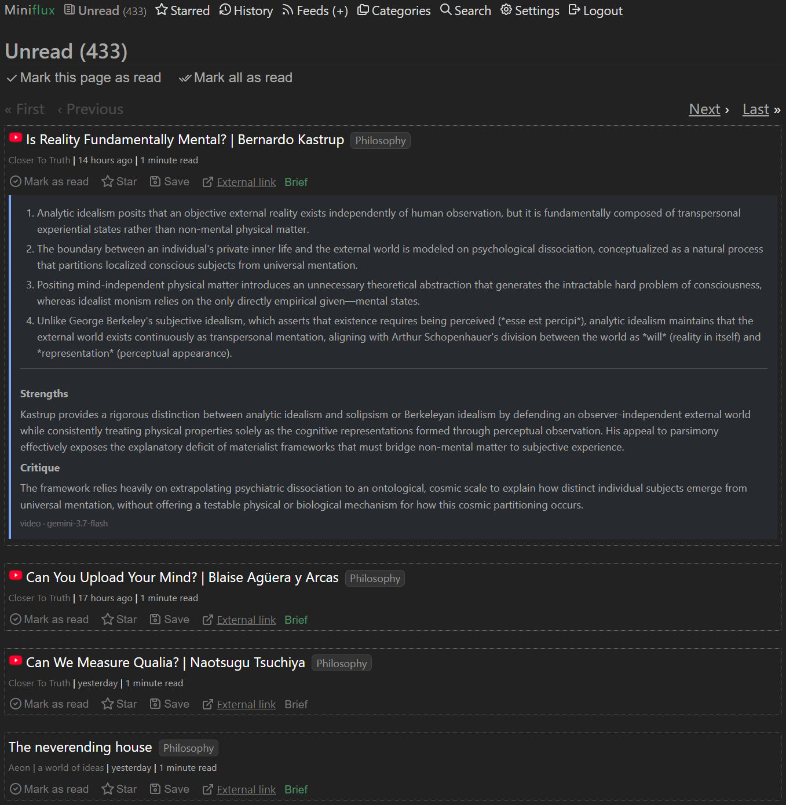

# miniflux-brief

`miniflux-brief` turns new Miniflux entries into short, useful briefs. It adds
the brief to the entry itself, so you can scan your unread list without opening
every article.



Each brief contains:

- 3–5 key takeaways
- strengths
- a short critique

Articles use any OpenAI-compatible text model. YouTube videos can optionally be
sent directly to Gemini.

## What it does

- Summarizes new entries from a Miniflux webhook.
- Adds an optional **Brief** button for older entries and manual re-runs.
- Preserves the original entry and avoids duplicating briefs.
- Retries temporary model and Miniflux failures safely.
- Keeps article fetching in a restricted container with private-network access
  blocked.

## Requirements

- An existing Miniflux installation
- Docker Engine with Docker Compose v2
- An OpenAI-compatible API endpoint, key, and model name
- Optional: a Gemini API key for YouTube videos

## Install

If you are replacing an existing systemd installation, do **not** start here.
Follow the [migration guide](docs/MIGRATION.md) so the old writer and SQLite
database are backed up and cut over safely.

For a new installation:

```bash
git clone https://github.com/diskya/miniflux-brief.git
cd miniflux-brief
cp .env.example .env
chmod 600 .env
```

Generate two different secrets:

```bash
openssl rand -hex 32  # FEEDSUM_WEBHOOK_SECRET
openssl rand -hex 32  # FEEDSUM_UI_TOKEN
```

In Miniflux, open **Settings → API Keys** and create a key for feedsum. Then edit
`.env` and fill in that key, your Miniflux URL, both generated secrets, and your
model settings. Every option is explained in [.env.example](.env.example).

Apply the reader isolation rules, then start the stack:

```bash
sudo ops/reader-firewall.sh --apply
sudo ops/reader-firewall.sh --check
docker compose up -d --wait
curl --fail http://127.0.0.1:8012/healthz
```

The stack contains the summarizer, article reader, API gateway, and restricted
egress proxy. Miniflux itself is not included.

## Connect Miniflux

### 1. Add the webhook

Open **Settings → Integrations → Webhook** and enter:

- URL: `http://127.0.0.1:8012/webhook` when Miniflux runs directly on the same
  host
- Secret: the value of `FEEDSUM_WEBHOOK_SECRET`

Containerized Miniflux must reach feedsum through a shared Docker network or the
Docker host gateway. See the [migration guide](docs/MIGRATION.md#1-preflight-without-changing-anything)
for the supported URL choices. Private webhook URLs may require
`INTEGRATION_ALLOW_PRIVATE_NETWORKS=1` in Miniflux.

### 2. Optional: add the Brief button

Paste [ops/custom.js](ops/custom.js) into **Settings → Custom JavaScript** and
[ops/custom.css](ops/custom.css) into **Settings → Custom CSS**. The browser asks
for `FEEDSUM_UI_TOKEN` once per session; no secret is stored in this repository.

Miniflux only allows the script to call its own origin, so your existing reverse
proxy must forward `/_summary/` to feedsum. For Caddy:

```caddyfile
feeds.example.com {
    handle /_summary/* {
        uri strip_prefix /_summary
        reverse_proxy 127.0.0.1:8012
    }
    reverse_proxy 127.0.0.1:8080
}
```

An [nginx example](examples/nginx.conf) is also included. Keep the endpoint on
the same origin as Miniflux and do not enable permissive CORS. A Miniflux login
cookie does not protect feedsum; all Brief API requests require the separate UI
token.

The button colors show the current state:

| Button | Meaning |
| --- | --- |
| Grey | Not summarized yet |
| Amber | Working or waiting to retry |
| Green | Brief is ready |
| Red | Brief failed; click to see the reason |

## Essential configuration

| Variable | Purpose |
| --- | --- |
| `MINIFLUX_URL` | Miniflux address reachable from the feedsum container |
| `MINIFLUX_API_TOKEN` | Reads entries and writes briefs back |
| `FEEDSUM_WEBHOOK_SECRET` | Verifies Miniflux webhook signatures |
| `FEEDSUM_UI_TOKEN` | Protects the optional Brief API and button |
| `OPENAI_API_BASE` | OpenAI-compatible `/v1` endpoint |
| `OPENAI_API_KEY` | API credential; use any non-empty value for local Ollama |
| `FEEDSUM_TEXT_MODEL` | Model used for articles |
| `GEMINI_API_KEY` | Optional, comma-separated keys for YouTube videos |
| `FEEDSUM_FEED_IDS` | Optional feed-ID allowlist for automatic briefs |
| `FEEDSUM_WRITE_BACK` | Set to `0` to keep briefs out of entry content |

## Everyday commands

```bash
docker compose ps                 # check service health
docker compose logs -f feedsum    # follow summarizer logs
docker compose restart feedsum    # restart only the summarizer
docker compose down               # stop the stack; keeps the data volume
```

After stopping the complete stack, remove its host firewall rules with:

```bash
sudo ops/reader-firewall.sh --remove
```

To update:

```bash
git pull --ff-only
docker compose build --pull
docker compose up -d --wait
sudo ops/reader-firewall.sh --check
```

## Security and data

Summaries, job state, and saved original entry content are stored in the
`feedsum-data` Docker volume. `docker compose down` keeps this volume; do not use
`docker compose down -v` unless you intend to delete that data.

The reader intentionally fails closed without its filtering proxy and host
firewall rules. Read [SECURITY.md](SECURITY.md) before changing its networks,
proxy, fixed addresses, or browser settings.

## Development

```bash
python3 -m venv .venv
.venv/bin/pip install -r requirements-dev.txt -r reader/requirements.txt
.venv/bin/pytest -q
.venv/bin/ruff check .
.venv/bin/ruff format --check .
```

The full isolated container and egress test is:

```bash
sudo ops/verify-stack.sh
```

It uses dummy credentials, a temporary database and volume, and non-production
ports. It does not read `.env` or the legacy `/var/lib/feedsum` database.

## Limitations

- Video summarization currently supports YouTube only.
- Pages that block extraction or provide too little article text fail with a
  visible reason instead of asking the model to guess.
- Avoid bulk-queuing a large backlog; it can exhaust model quotas and trigger
  source-site rate limits.

## License

MIT — see [LICENSE](LICENSE).
